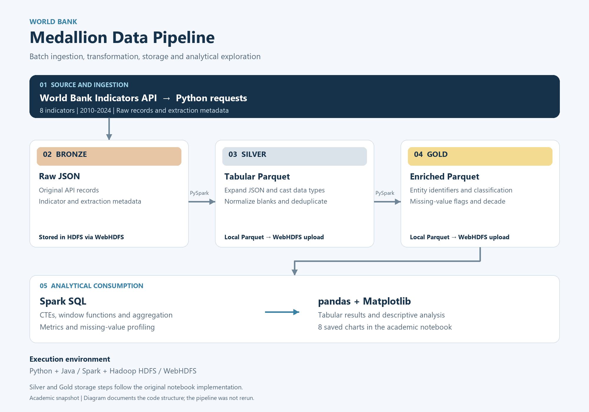
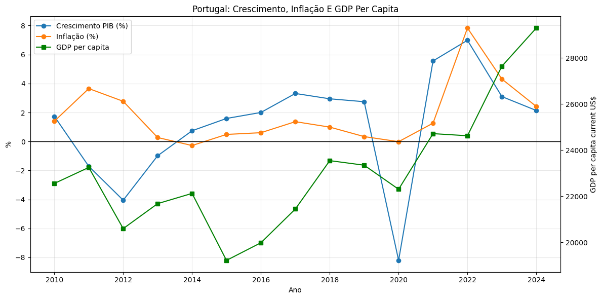
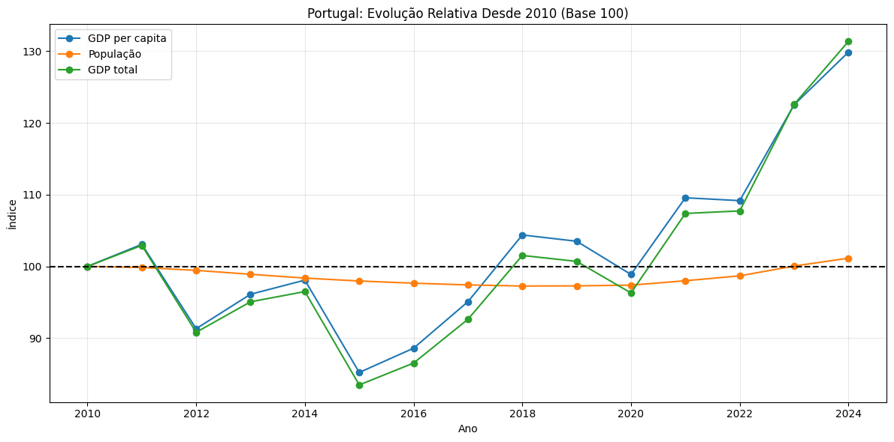

# World Bank Medallion Pipeline

**Academic data engineering and analytics project using Python, PySpark, Spark SQL, Hadoop HDFS and Parquet.**

This project ingests economic and demographic indicators from the World Bank API, organizes the data into Bronze, Silver and Gold layers, and explores selected macroeconomic trends with SQL and visualizations.

**Project status:** academic notebook snapshot with saved outputs. Environment portability and analytical interpretation improvements are documented in [Known limitations](#known-limitations). The original notebook is preserved; this repository packaging does not claim a fresh end-to-end execution.

## Project Overview

- **Source:** World Bank Indicators API.
- **Period:** 2010–2024.
- **Scope:** 8 indicators across countries and international aggregates.
- **Architecture:** batch pipeline with Bronze, Silver and Gold layers.
- **Storage:** raw JSON and Parquet, with data stored in HDFS.
- **Analysis:** Spark SQL, pandas and Matplotlib.

The project demonstrates an academic implementation of data ingestion, transformation, storage and analysis. No production throughput or scalability benchmark is claimed.

## Architecture



[Vector diagram (SVG)](docs/images/pipeline_architecture.svg) · [Editable Mermaid source](docs/architecture.mmd)

In the current implementation, Silver and Gold Parquet files are written locally and then uploaded to HDFS through the Python WebHDFS client. Spark reads the stored data using the environment's `webhdfs://` configuration.

## Data Layers

| Layer | Main operations | Output |
| --- | --- | --- |
| Bronze | API extraction, extraction timestamp and indicator metadata | Raw JSON in HDFS |
| Silver | Expand nested JSON, cast types, normalize empty strings, remove duplicates and add extraction date | Tabular Parquet stored in HDFS |
| Gold | Add entity identifiers, missing-value flags, decade and entity classification | Enriched Parquet stored in HDFS |

## Indicators

| Code | Indicator |
| --- | --- |
| `NY.GDP.MKTP.CD` | GDP, current US dollars |
| `NY.GDP.MKTP.KD.ZG` | GDP growth, annual percentage |
| `NY.GDP.PCAP.CD` | GDP per capita, current US dollars |
| `FP.CPI.TOTL.ZG` | Inflation, consumer prices, annual percentage |
| `GC.DOD.TOTL.GD.ZS` | Central government debt, percentage of GDP |
| `GC.REV.XGRT.GD.ZS` | Revenue, excluding grants, percentage of GDP |
| `NE.CON.GOVT.ZS` | General government final consumption expenditure, percentage of GDP |
| `SP.POP.TOTL` | Total population |

The indicator labels above use their intended definitions. Some labels and interpretations in the original academic notebook still require the corrections described below.

## Implementation Highlights

- Extract indicators with `requests`, a request timeout and HTTP status checking.
- Preserve raw API records and extraction metadata.
- Expand nested structures using PySpark DataFrame operations.
- Convert values and dates to suitable data types.
- Normalize empty string fields and deduplicate records within an extraction.
- Store transformed data as Parquet and upload it to HDFS.
- Use Spark SQL CTEs, conditional aggregation and `ROW_NUMBER()`.
- Profile missing values and produce 8 saved visualizations.

## Example Visualizations

[Open the complete gallery: all 8 original charts and interpretation notes](docs/images/README.md).

These images are extracted from the saved academic notebook outputs. They have not been regenerated from a fresh run of this package. They illustrate the presentation and descriptive analysis, rather than an audited economic conclusion.

### Portugal: GDP growth, inflation and GDP per capita



### Portugal: indexed GDP and population trends



## Repository Structure

```text
worldbank-medallion-pipeline/
├── README.md
├── requirements.txt
├── .gitignore
├── notebooks/
│   └── worldbank_medallion_pipeline.ipynb
└── docs/
    ├── architecture.mmd
    ├── COMO_COLOCAR_NO_GITHUB.md
    └── images/
        ├── README.md
        ├── pipeline_architecture.png
        ├── pipeline_architecture.svg
        └── 8 original chart PNG files
```

## Running the Notebook

### Environment requirements

- Python; the original notebook metadata records Python 3.12.3.
- A Java/Spark combination compatible with the available cluster.
- A reachable Hadoop HDFS installation with WebHDFS enabled and writable directories.
- Spark configured to resolve and read the environment's `webhdfs://` paths.
- The Python packages listed in `requirements.txt`.

The original Spark, Hadoop and Java versions were not supplied. Match the PySpark version to the working cluster rather than assuming the latest release is compatible. The package list is a dependency inventory, not a tested environment lockfile. `pyspark[sql]` includes the SQL-related Python extras; use a PySpark version compatible with your working Spark environment.

### Steps

1. Open `notebooks/worldbank_medallion_pipeline.ipynb` in the configured Jupyter/Spark environment.
2. Review all `HDFS_HTTP`, `HDFS_WEB`, `HDFS_BRONZE_DIR`, `HDFS_SILVER_DIR` and `HDFS_GOLD_DIR` values. They currently reference the original academic environment. Adjust the WebHDFS user if needed.
3. Ensure the Bronze, Silver and Gold parent directories exist and are writable. Ensure local output directories refer to the intended local filesystem for the chosen Spark configuration.
4. Before executing the analysis, replace the wildcard Gold read with `spark.read.parquet(gold_path)` to analyze the current extraction only. Reading all snapshots can duplicate observations across runs.
5. Apply the analytical interpretation corrections described below before presenting the affected charts as results.
6. Restart the kernel and run the cells in order: Bronze → Silver → Gold → SQL analysis and charts.
7. Check schema, row counts, duplicate keys and missing-value summaries before interpreting the outputs.

For a suitable cluster environment, the Python packages can be installed with:

```bash
python -m pip install -r requirements.txt
```

Installing these packages alone does not provision Hadoop, configure Java or create the original academic environment.

## Known Limitations

- **Environment-specific configuration:** hostnames, port, user and paths are hard-coded for the academic setup. They should be centralized in configuration before reuse elsewhere.
- **Multiple snapshots:** `gold_worldbank_*` can load repeated extractions. The current deduplication key includes the extraction timestamp, so it does not remove repeated observations across different snapshots.
- **API pagination:** the extractor requests up to 20,000 records per indicator in one request. Generalizing the period or data scope requires checking the API pagination metadata and fetching additional pages when needed.
- **Fiscal interpretation:** `NE.CON.GOVT.ZS` measures general government final consumption, not total government spending. Subtracting it from revenue does not provide a government budget balance. The notebook's `balance_proxy` chart and its budget-balance interpretation should be removed or redesigned using appropriate, comparable indicators.
- **Exploratory measures:** the debt/revenue ratio and the inflation-minus-growth comparison should be described by their formulas, with limited interpretation, rather than presented as validated fiscal or stress indicators.
- **Narrative cleanup:** the text following the Portugal macroeconomic chart repeats a description of another chart and needs replacement.
- **Validation:** saved outputs are present, but the notebook execution counters are not sequential. A clean end-to-end run, reproducible environment specification and automated data checks remain to be completed.

## Next Improvements

- Centralized environment configuration and reproducible setup.
- API pagination and retry/backoff handling.
- Explicit single-snapshot analysis or latest-record selection.
- Schema and data-quality checks between layers.
- Separation of ingestion, transformation and analysis into reusable functions.
- Tests on a small local fixture and an execution summary with row counts.

## Data Sources and References

- [World Bank Indicators API documentation](https://datahelpdesk.worldbank.org/knowledgebase/articles/889392)
- [API parameters and pagination](https://datahelpdesk.worldbank.org/knowledgebase/articles/898581-api-basic-call-structures)
- [General government final consumption: definition](https://databank.worldbank.org/metadataglossary/world-development-indicators/series/NE.CON.GOVT.ZS)
- [Revenue, excluding grants: definition](https://databank.worldbank.org/metadataglossary/world-development-indicators/series/GC.REV.XGRT.GD.ZS)

World Bank data remains subject to the terms and attribution requirements of its source dataset.

## Author

**Miguel Ferreira**  
[LinkedIn](https://www.linkedin.com/in/miguel-ferreira-567678268/) · [GitHub](https://github.com/miguelhbpferreira-dev)
