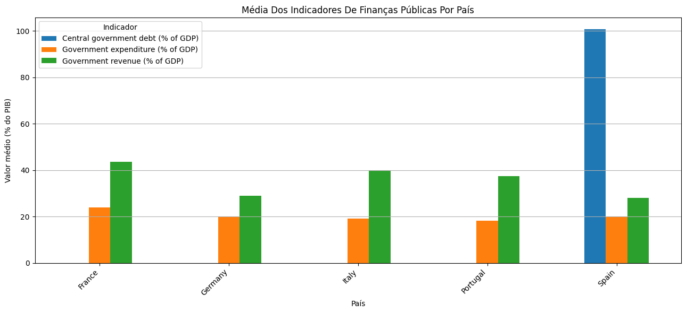
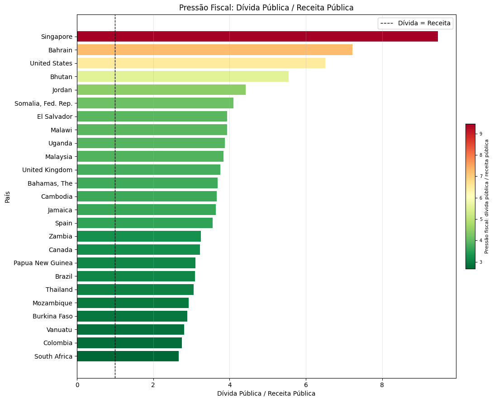
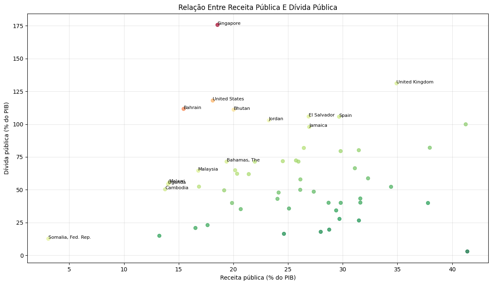
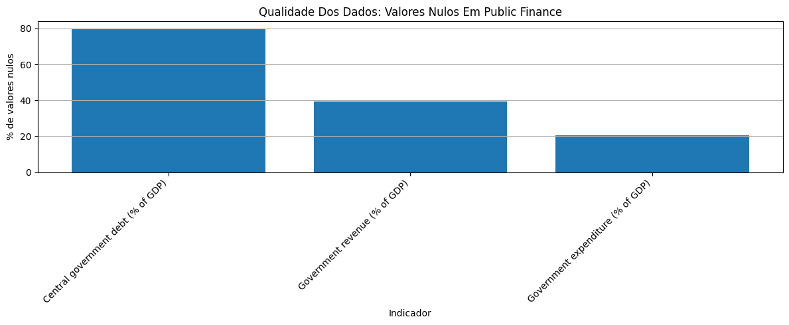
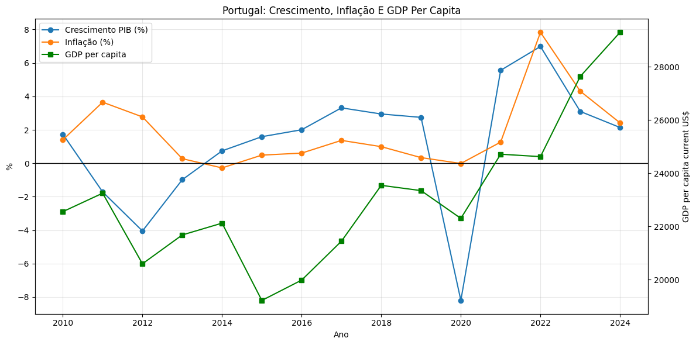
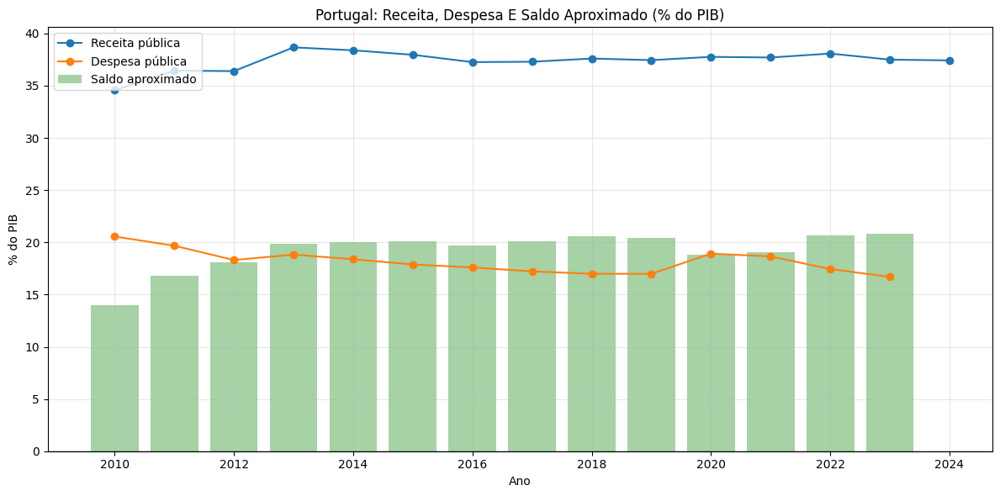
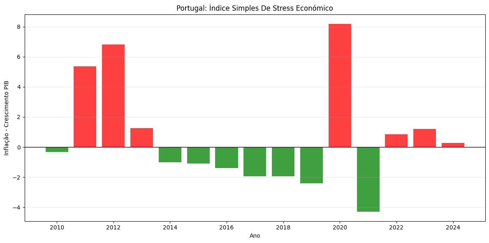
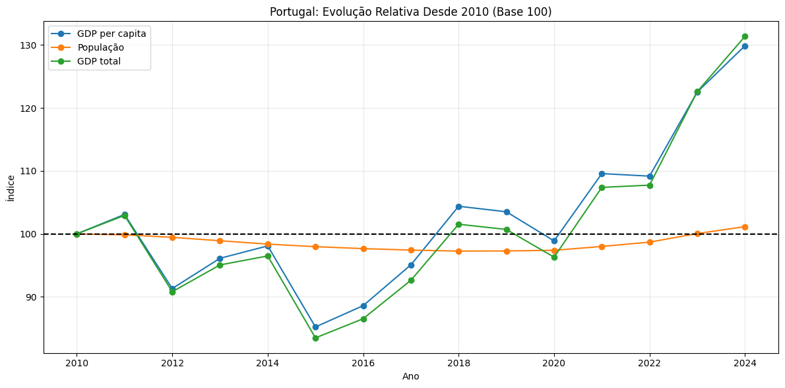

# Notebook Chart Images

All 8 PNG files were extracted without modification from the saved notebook outputs. No data was downloaded and no chart was recomputed.

The two files ending in `_original` require particular care: their original fiscal/stress interpretations should be revised before using them as portfolio findings.

| File | Original notebook cell (zero-based) | Chart | Notes |
| --- | --- | --- | --- |
| [public_finance_comparison.png](public_finance_comparison.png) | 23 | Public finance comparison | Original labels include government expenditure; this series measures government final consumption. Review before interpreting. |
| [debt_revenue_ranking.png](debt_revenue_ranking.png) | 25 | Debt-to-revenue ranking | The original title uses fiscal pressure. Treat this as a descriptive debt/revenue ratio, not a validated fiscal-pressure indicator. |
| [debt_revenue_scatter.png](debt_revenue_scatter.png) | 27 | Debt and revenue scatter | Descriptive comparison. The color encodes debt/revenue; compare coverage and observation years before drawing conclusions. |
| [public_finance_missing_values.png](public_finance_missing_values.png) | 29 | Missing values by indicator | Original saved snapshot. Indicator names and snapshot selection require the same review as the notebook. |
| [portugal_macro.png](portugal_macro.png) | 30 | Portugal macroeconomic indicators | GDP growth and inflation use the left axis; GDP per capita in current US dollars uses the right axis. |
| [portugal_fiscal_comparison_original.png](portugal_fiscal_comparison_original.png) | 32 | Original fiscal comparison | Requires correction: the chart uses government final consumption as total spending and derives a misleading budget-balance proxy. Retained only as an original notebook output. |
| [portugal_stress_index_original.png](portugal_stress_index_original.png) | 34 | Original inflation-minus-growth chart | Exploratory difference defined in the notebook. It is not a validated economic stress index. |
| [portugal_indexed.png](portugal_indexed.png) | 36 | Portugal indexed trends | Series normalized to the first year. GDP series are in current US dollars; this is not an inflation-adjusted real-growth comparison. |

## Pipeline Diagram

[PNG](pipeline_architecture.png) · [SVG](pipeline_architecture.svg) · [Editable Mermaid](../architecture.mmd)

## Chart Previews

### Public finance comparison

Original labels include government expenditure; this series measures government final consumption. Review before interpreting.

### Debt-to-revenue ranking

The original title uses fiscal pressure. Treat this as a descriptive debt/revenue ratio, not a validated fiscal-pressure indicator.

### Debt and revenue scatter

Descriptive comparison. The color encodes debt/revenue; compare coverage and observation years before drawing conclusions.

### Missing values by indicator

Original saved snapshot. Indicator names and snapshot selection require the same review as the notebook.

### Portugal macroeconomic indicators

GDP growth and inflation use the left axis; GDP per capita in current US dollars uses the right axis.

### Original fiscal comparison

Requires correction: the chart uses government final consumption as total spending and derives a misleading budget-balance proxy. Retained only as an original notebook output.

### Original inflation-minus-growth chart

Exploratory difference defined in the notebook. It is not a validated economic stress index.

### Portugal indexed trends

Series normalized to the first year. GDP series are in current US dollars; this is not an inflation-adjusted real-growth comparison.

